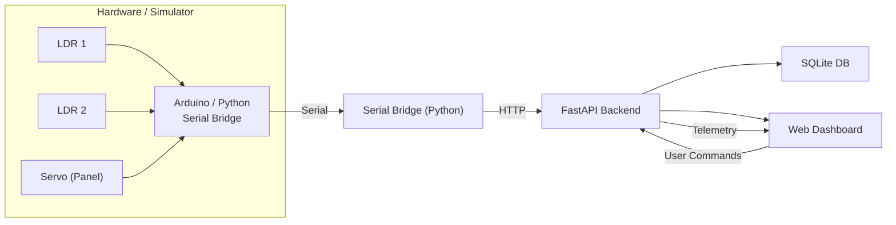

# Solar Tracker Monitoring system

## Overview

This repository demonstrates a full‑stack solar‑tracking system that combines embedded hardware, an IoT bridge, a backend API, and a web dashboard to monitor and control a small single‑axis solar panel tracker. The project is intentionally self‑contained so you can run the entire stack on a single Windows machine (or Linux/macOS with minor adjustments), and includes a software simulator so you don't need physical hardware to experiment.

Key components:

- Embedded hardware – Arduino firmware (firmware/solar_tracker) that reads two Light Dependent Resistors (LDRs) and drives a servo to orient the panel. If you don't have an Arduino the simulator mimics the same behaviour.
- IoT bridge – a Python serial bridge (simulator/serial_bridge.py) that forwards telemetry and commands between the Arduino and the backend. When using the simulator the bridge is optional because the simulator talks directly to the API.
- Backend API – a FastAPI service (backend/app.py) that validates and stores telemetry in a SQLite database, queues commands for the device, serves history endpoints, and hosts the web dashboard.
- Web dashboard – an interactive UI (frontend) that visualises sensor readings, panel orientation, live telemetry, and provides manual controls and configuration.

The system is designed for experimentation, education, and as a reference implementation for small IoT projects that need reliable telemetry, rate-limiting, command queues and simple fault detection.

---

## Architecture



Important implementation notes:

- Control law (shared/control.py): the raw LDR values pass through a median filter to reject sporadic spikes, then into a dead‑band to avoid tiny oscillatory moves. A 3‑sample consensus step ensures transient disagreements are ignored. The final move is a clamped proportional step with a short settle delay to stabilise the servo.
- Backend (backend/app.py): accepts telemetry, records accepted and rejected commands, exposes historical endpoints for light, orientation and faults, and provides a server‑sent events (SSE) stream for the dashboard.
- Simulator (simulator/device_sim.py): simulates a sun model (position + intensity) and the Arduino behaviour, allowing full system tests without hardware.

---

## Quick Start (Windows)

1. Create a virtual environment and install dependencies:

```bat
python -m venv .venv
.\.venv\Scripts\activate
pip install -r requirements.txt
```

2. Start the backend and simulator (two terminals):

Terminal 1 — start API + dashboard:

```bat
python -m uvicorn backend.app:app --host 127.0.0.1 --port 8000
```

Terminal 2 — start simulator:

```bat
python -m simulator.device_sim
```

Or run both with the convenience script:

```bat
run_all.bat
```

3. The first run will create a `.env` file containing a generated `SOLAR_API_KEY`. Open the dashboard at http://127.0.0.1:8000 in your browser, paste the `SOLAR_API_KEY` into the dashboard's prompt and click Connect. The dashboard keeps the key in session storage only; do not commit `.env` to version control.

Notes:

- The backend binds to localhost by default. If you need external access use a trusted reverse proxy with HTTPS — do not expose the backend directly to an untrusted network.
- Protected API routes require the `X-API-Key` header.

---

## Running with a Real Arduino

1. Flash the Arduino with the firmware located in `firmware/solar_tracker`.
2. Connect the board to your machine. Ensure you do not have another Serial Monitor open.
3. Find the COM port:

```bat
python -m simulator.serial_bridge --list
```

4. Start the backend (Terminal 1):

```bat
python -m uvicorn backend.app:app --host 127.0.0.1 --port 8000
```

5. Start the serial bridge (Terminal 2), replacing COM5 with your port name:

```bat
python -m simulator.serial_bridge --port-name COM5
```

6. Open the dashboard, enter `SOLAR_API_KEY`, and Connect. The panel will now show live sensor data.

The serial bridge forwards lines between the Arduino and the backend and maps simple `OK`/`ERR` replies back into command results. See "Known Limitations" below for protocol caveats.

---

## Manual Commands

- Start backend only:

```bat
python -m uvicorn backend.app:app --host 127.0.0.1 --port 8000
```

- Run simulator only (no hardware):

```bat
python -m simulator.device_sim
```

- Run serial bridge listing available ports:

```bat
python -m simulator.serial_bridge --list
```

---

## API Examples

Sample telemetry POST payload (JSON):

```json
{
  "device_id": "solar-tracker-01",
  "left_ldr": 412,
  "right_ldr": 378,
  "angle": 42.5,
  "mode": "auto",
  "timestamp": "2026-10-16T12:34:56.789Z"
}
```

Sample command POST payload (send a move command):

```json
{
  "type": "move",
  "angle": 75.0
}
```

Auth: Include the `X-API-Key` HTTP header for all protected routes.

Rate limits: telemetry endpoints are limited to 300 requests per client IP per minute; other routes default to 200 requests per minute.

---

## Configuration (Environment Variables)

| Variable | Default | Meaning |
|----------|---------|---------|
| `SOLAR_DEVICE_ID` | `solar-tracker-01` | Expected device identifier. Devices that post telemetry must use this id unless your configuration overrides it. |
| `SOLAR_OFFLINE_AFTER` | `10` | Seconds of inactivity before the device is marked offline in the backend. |
| `SOLAR_COMMAND_EXPIRE` | `60` | Seconds before a pending command expires if not fetched/executed by the device. |
| `SOLAR_API_KEY` | Required | Shared secret for protected API routes — generated in `.env` on first run. Keep it private. |
| `SOLAR_DB_PATH` | `backend/solar_tracker.db` | SQLite database file path. When using Docker the file is persisted in a named volume. |

---

## Control Algorithm — How It Works

The control pipeline is implemented in `shared/control.py`. Key stages:

1. Sensor capture: the device samples two LDRs at regular ticks (Arduino default 200 ms, simulator default 500 ms). Readings are integer ADC values.
2. Median filter: a short median removes single-sample spikes.
3. Dead‑band: small differences between left/right are ignored to prevent hunting.
4. Consensus: three consecutive samples must agree before a move is considered, preventing single-sample noise from triggering a move.
5. Proportional step + clamp: the controller computes a proportional move scaled to a maximum step size and clamps the result to physical servo limits.
6. Settle delay: after a commanded move the controller waits briefly for the servo to settle before accepting further moves.

This design favours stability over aggressive tracking — appropriate for low‑cost sensors and slow mechanical systems.

---

## Testing

Run tests with the development requirements:

```bat
pip install -r requirements-dev.txt
python -m pytest tests/ -v
python -m ruff check backend shared simulator tests
```

All unit and integration tests run against temporary databases and a FastAPI test client — no live server or physical Arduino is required.

---

## Docker

Create `.env` with a generated `SOLAR_API_KEY` via:

```bat
python ensure_env.py
```

Then build and run with Docker Compose:

```bat
docker compose up --build
```

When using hardware, run the serial bridge on the host machine and keep the same `.env` file so the bridge and API share the same API key.

---

## Wiring and Bill of Materials

See `docs/wiring.md` for the wiring schematic, connector pinouts, and the component list with recommended part numbers.

---

## Known Limitations & Troubleshooting

- Both‑LDR common‑mode blind spot: if both LDRs fail with the same value (e.g. both shorted, both shaded, or a common connector fault), the controller sees no differential and will hold position without raising `SENSOR_FAULT`. Adding a third reference sensor or an absolute plausibility check can mitigate this.
- Fault recovery: currently a latched sensor fault freezes the actuator (including manual moves) until the sensor readings return to normal. There's no remote override short of cycling power.
- Serial command correlation: the Arduino serial protocol has no command IDs; the serial bridge attributes `OK`/`ERR` replies FIFO to pending commands. Unsolicited `OK` messages from debug commands can be misattributed.

Troubleshooting tips:
- If the dashboard reports "offline", confirm the device is posting telemetry and that the `SOLAR_API_KEY` in `.env` matches the dashboard key.
- If using hardware and the bridge fails to open a port, make sure no other process (e.g., Arduino IDE Serial Monitor) has the port open and verify driver installation.

---

## File Structure (high‑level)

- backend/ — FastAPI application and DB migrations
- firmware/ — Arduino sketch and build instructions
- simulator/ — device simulator and serial bridge
- shared/ — control logic and shared types
- frontend/ — dashboard UI (static files served by backend)
- tests/ — pytest test suites
- docs/ — wiring diagrams, BOM and notes

---

## Contributing

Contributions are welcome. Please:

1. Fork the repository.
2. Create a feature branch: `git checkout -b feat/your-change`.
3. Run the existing test suite and linter: `python -m pytest` and `python -m ruff check --fix backend shared simulator tests`.
4. Open a Pull Request with a clear description and tests for new behaviour.

---

## License

This project is released under the MIT License.
