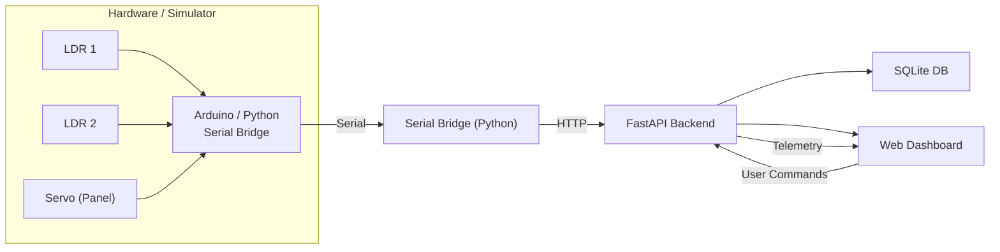

# Solar Tracker Monitoring system

## Overview

This repository demonstrates a **full‑stack solar‑tracking system** that combines:

- **Embedded hardware** – an Arduino (or simulated device) equipped with two Light Dependent Resistors (LDRs) and a servo to orient a solar panel.
- **IoT bridge** – a Python serial‑bridge that forwards telemetry and commands between the Arduino and the backend.
- **Backend API** – a FastAPI service (`backend/app.py`) that stores telemetry in a SQLite database, validates commands, and serves a live dashboard.
- **Web dashboard** – an interactive UI built with modern web technologies that visualises light levels, panel orientation, and lets the user manually control the tracker.

The project is deliberately self‑contained and runs on **Windows** with a single `requirements.txt` install.  If you don’t have the hardware, a **software simulator** (`simulator/device_sim.py`) reproduces the same behaviour.

---

## Architecture



- **Control law** (`shared/control.py`): median filter → dead‑band → 3‑sample consensus → clamped proportional step → settle delay. This stabilises the servo against noisy LDR readings.
- **Backend** (`backend/app.py`): receives telemetry, records accepted and rejected commands, provides history endpoints, and serves the dashboard UI.
- **Simulator** (`simulator/device_sim.py`): mimics the Arduino’s behaviour using a synthetic sun model, allowing the whole stack to run without any physical board.

---

## Quick Start (Windows)

```bat
rem Install dependencies
pip install -r requirements.txt

rem Run everything (backend + simulator) in two windows
run_all.bat
```

- Launch scripts create `.env` with a strong random API key on first run. Open `.env`, enter its key in the dashboard, and keep it private.
- `run_all.bat` launches the FastAPI server on `http://127.0.0.1:8000` and the device simulator side-by-side.
- Open the URL in a browser, paste `SOLAR_API_KEY` from `.env` into the dashboard, and choose **Connect**.
- The browser stores the key in session storage only. The simulator and serial bridge load the same local `.env` automatically.
- Protected API routes fail closed if the key is missing or still has the example placeholder. Health, control configuration, and static dashboard files remain public.

The shared key is sent in an `X-API-Key` header. The default setup binds to localhost. Do not expose the HTTP server directly to an untrusted network; use HTTPS through a trusted reverse proxy for remote access.

### Running with a Real Arduino

1. Flash the Arduino with the firmware located in `firmware/solar_tracker`.
2. Connect the board (ensure **no other Serial Monitor is open**).  Find the COM port with:
   ```bat
   python -m simulator.serial_bridge --list
   ```
3. Start the backend and the serial bridge:
   ```bat
   rem Either run run_arduino.bat COM5, or initialize .env with:
   python ensure_env.py
   :: Terminal 1 – API + dashboard
   python -m uvicorn backend.app:app --host 127.0.0.1 --port 8000

   :: Terminal 2 – Serial bridge
   python -m simulator.serial_bridge --port-name COM5   # replace COM5 with yours
   ```
4. The dashboard will now display real sensor data and you can control the panel.

---

## Manual Commands

```bat
rem Backend only
python -m uvicorn backend.app:app --host 127.0.0.1 --port 8000

rem Simulator only (no hardware)
python -m simulator.device_sim
```

---

## Testing

```bat
pip install -r requirements-dev.txt
python -m pytest tests/ -v
python -m ruff check backend shared simulator tests
```

The API, database, simulator, and control tests use temporary databases and an in-process FastAPI test client; no live server or physical Arduino is required.

---

## API Reference

| Method | Path | Description |
|--------|------|-------------|
| **GET** | `/api/health` | Liveness probe |
| **GET** | `/api/config` | Returns control thresholds |
| **GET** | `/api/state` | Current device snapshot |
| **GET** | `/api/events` | Server‑sent events: live state/counts stream |
| **POST** | `/api/telemetry` | Device uploads LDR values & angle |
| **GET** | `/api/history/light` | Time‑series of LDR samples |
| **GET** | `/api/history/orientation` | Angle & mode changes |
| **GET** | `/api/history/faults` | Sensor‑fault events |
| **GET** | `/api/history/commands` | Command audit trail (accepted + refused) |
| **GET** | `/api/summary` | Counters and statistics |
| **POST** | `/api/commands` | Send `move`, `set_mode` or `park` commands |
| **GET** | `/api/commands/pending` | Devices poll queued commands |
| **GET** | `/api/commands/{id}` | Fetch one command's current status |
| **POST** | `/api/commands/{id}/result` | Device reports command outcome |
| **DELETE** | `/api/commands/pending` | Cancel queued commands for a device |
| **DELETE** | `/api/history` | Clear samples, orientation events, and completed command history |

All routes except `/api/health` and `/api/config` require the shared
`X-API-Key` header. Telemetry ingestion is limited to **300 requests per
client IP per minute**; every other route shares a global default limit of
**200 requests per minute** to allow for the firmware reporting interval.
Free-text telemetry and command-result fields have length limits.

The dashboard reconnects to authenticated SSE using the last received event ID, then falls back to adaptive five-second polling while disconnected (backing off further if the backend rate-limits it) and idles at ten seconds while SSE is live. It includes timestamped charts, a fault timeline, CSV/JSON exports, manual angle synchronization, and opt-in browser notifications.

---

## Configuration (Environment Variables)

| Variable | Default | Meaning |
|----------|---------|---------|
| `SOLAR_DEVICE_ID` | `solar-tracker-01` | Expected device identifier |
| `SOLAR_OFFLINE_AFTER` | `10` | Seconds of inactivity before the device is marked offline |
| `SOLAR_COMMAND_EXPIRE` | `60` | Seconds before a pending command expires |
| `SOLAR_API_KEY` | Required | Shared secret for protected API routes |
| `SOLAR_DB_PATH` | `backend/solar_tracker.db` | SQLite database file path |

## Docker

Run `python ensure_env.py` to create `.env` with a strong API key, then run:

```bat
docker compose up --build
```

Docker Compose persists SQLite data in a named volume. For hardware access, run the serial bridge on the host with the same `.env` key.

## Wiring and Bill of Materials

See [docs/wiring.md](docs/wiring.md) for the wiring schematic and component list.

---

## How It Works – Step‑by‑Step

1. **Sensor Capture** – Two LDRs measure ambient light.  The Arduino firmware
   reads them every 200 ms (`TICK_MS`); the software simulator defaults to one
   tick every 500 ms (`--period`, tunable).
2. **Control Algorithm** – The raw readings go through a median filter, a dead‑band, and a consensus check (three consecutive agreeing samples). The algorithm then computes a proportional step to drive the servo, with a settle delay to avoid hunting.
3. **Telemetry Upload** – The device sends a JSON payload (`/api/telemetry`) containing the LDR values, current angle, and mode.
4. **Backend Persistence** – FastAPI stores each telemetry entry and the computed orientation in SQLite, exposing history endpoints for the UI.
5. **Command Queue** – Users interact with the dashboard to issue commands (`move`, `set_mode`, `park`). Commands are queued in the database and fetched by the device via `/api/commands/pending`.
6. **Result Reporting** – After executing a command, the device POSTs the result (`/api/commands/{id}/result`). The backend records success or rejection reasons, which the dashboard displays.

---

## Known Limitations

* **Both‑LDR common‑mode blind spot** – the fault detector only triggers when
  *exactly one* sensor is welded to an ADC rail while its twin reads a healthy
  value.  If **both** LDRs fail identically (shared connector pulled, both
  shaded, shorted together), the differential simply collapses into the
  deadband and the controller holds position without raising `SENSOR_FAULT`.
  This is a deliberate engineering trade‑off (a genuine "both sides equally
  bright" lighting condition is indistinguishable from a common‑mode wiring
  failure using only two sensors), but it means the most likely real wiring
  fault — a loose shared connector — is silent.  A third reference sensor or
  a plausibility check on absolute levels would close this gap.
* **Fault recovery is manual** – a latched sensor fault freezes the actuator
  (including manual moves and park) until the sensor readings return to the
  healthy range; there is no remote override short of a power cycle.
* **Command correlation over serial** – the Arduino protocol has no command
  id, so the serial bridge matches `OK`/`ERR` replies to the oldest
  outstanding command (FIFO).  Unsolicited `OK` lines (e.g. from the `SWEEP`
  debug command) issued while commands are pending would be mis-attributed.

---

## License

This project is released under the MIT License.

---

## Contributing

Feel free to open issues or PRs.  Follow the usual `ruff` formatting (`python -m ruff check --fix backend shared simulator tests`) and add tests for new functionality.
