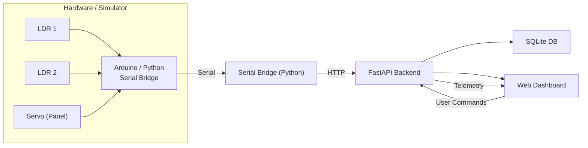

# Solar Tracker Monitoring system

## Overview

This repository demonstrates a full‑stack solar‑tracking system that combines embedded hardware, an IoT bridge, a backend API, and a web dashboard to monitor and control a small single‑axis solar panel tracker. The project is intentionally self‑contained so you can run the entire stack on a single Windows machine (or Linux/macOS with minor adjustments), and includes a software simulator so you don't need physical hardware to experiment.

Key components:

- Embedded hardware – Arduino firmware (firmware/solar_tracker) that reads two Light Dependent Resistors (LDRs) and drives a servo to orient the panel. If you don't have an Arduino the simulator mimics the same behaviour.
- IoT bridge – a Python serial bridge (simulator/serial_bridge.py) that forwards telemetry and commands between the Arduino and the backend. When using the simulator the bridge is optional because the simulator talks directly to the API.
- Backend API – a FastAPI service (backend/app.py) that validates and stores telemetry in a SQLite database, queues commands for the device, serves history endpoints, and hosts the web dashboard.
- Web dashboard – an interactive UI (frontend) that visualises sensor readings, panel orientation, live telemetry, and provides manual controls and configuration.

The system is designed for experimentation, education, and as a reference implementation for small IoT projects that need reliable telemetry, rate-limiting, command queues and simple fault detection.

---

## Architecture



Important implementation notes:

- Control law (shared/control.py): the raw LDR values pass through a median filter to reject sporadic spikes, then into a dead‑band to avoid tiny oscillatory moves. A 3‑sample consensus step ensures transient disagreements are ignored. The final move is a clamped proportional step with a short settle delay to stabilise the servo.
- Backend (backend/app.py): accepts telemetry, records accepted and rejected commands, exposes historical endpoints for light, orientation and faults, and provides a server‑sent events (SSE) stream for the dashboard.
- Simulator (simulator/device_sim.py): simulates a sun model (position + intensity) and the Arduino behaviour, allowing full system tests without hardware.

---

## Quick Start (Windows)

1. Create a virtual environment and install dependencies:

```bat
python -m venv .venv
.\.venv\Scripts\activate
pip install -r requirements.txt
```

2. Start the backend and simulator (two terminals):

Terminal 1 — start API + dashboard:

```bat
python -m uvicorn backend.app:app --host 127.0.0.1 --port 8000
```

Terminal 2 — start simulator:

```bat
python -m simulator.device_sim
```

Or run both with the convenience script:

```bat
run_all.bat
```

3. Open the dashboard at http://127.0.0.1:8000 — no login or API key is needed. The first run creates `.env` from `.env.example` (optional settings such as `SOLAR_DEVICE_ID` and `SOLAR_DB_PATH`); the simulator and serial bridge load the same local `.env` automatically. Do not commit `.env` to version control.

Notes:
- The backend binds to localhost by default. There is no authentication on the API. If you need external access use a trusted reverse proxy with HTTPS — do not expose the backend directly to an untrusted network.

---

## Running with a Real Arduino

1. Flash the Arduino with the firmware located in `firmware/solar_tracker`.
2. Connect the board to your machine. Ensure you do not have another Serial Monitor open.
3. Find the COM port:

```bat
python -m simulator.serial_bridge --list
```

4. Start the backend (Terminal 1):

```bat
python -m uvicorn backend.app:app --host 127.0.0.1 --port 8000
```

5. Start the serial bridge (Terminal 2), replacing COM5 with your port name:

```bat
python -m simulator.serial_bridge --port-name COM5
```

6. Open the dashboard at http://127.0.0.1:8000 — the panel will now show live sensor data.

The serial bridge forwards lines between the Arduino and the backend and maps simple `OK`/`ERR` replies back into command results. See "Known Limitations" below for protocol caveats.

---

## Manual Commands

- Start backend only:

```bat
python -m uvicorn backend.app:app --host 127.0.0.1 --port 8000
```

- Run simulator only (no hardware):

```bat
python -m simulator.device_sim
```

- Run serial bridge listing available ports:

```bat
python -m simulator.serial_bridge --list
```

---

## Unattended Deployment

Ready-made service files live in [`deploy/`](deploy/) so the backend and
serial bridge survive reboots and auto-restart on crash.

### Windows (Task Scheduler)

```bat
python ensure_env.py
powershell -ExecutionPolicy Bypass -File deploy\install_windows_tasks.ps1
```

Installs `SolarTrackerBackend` and `SolarTrackerBridge` tasks that start at
logon and restart every minute on failure. Uninstall with `-Uninstall`.

### Linux (systemd)

```bash
# adjust the paths inside the unit files first
sudo cp deploy/solar-backend.service deploy/solar-bridge.service /etc/systemd/system/
sudo systemctl daemon-reload
sudo systemctl enable --now solar-backend solar-bridge
```

The bridge runs as user `solar` in group `dialout` for serial access.

### Remote access (TLS)

Never expose uvicorn directly. Terminate TLS on a reverse proxy that
forwards to `127.0.0.1:8000`:

- **Caddy** ([`deploy/Caddyfile`](deploy/Caddyfile)) — automatic Let's Encrypt
  certificates: `caddy run --config deploy/Caddyfile`
- **nginx** ([`deploy/nginx.conf.example`](deploy/nginx.conf.example)) —
  template with SSE-safe settings; pair with `certbot --nginx`

The API has no authentication - anyone who can reach the proxy can read
data and send commands, so only expose it on networks you trust.

### Bridge logs

The bridge writes rotating logs (`logs/serial_bridge.log`, 1 MB × 3 backups)
in addition to the console. Tune with `--log-file`, `--log-level`,
`--queue-size`, and `--flush-interval` (see `python -m simulator.serial_bridge --help`).
Dropped telemetry (backend outage or rate limit) is queued and retried at a
paced rate so retries never crowd out fresh samples.

---

## API Reference

| Method | Path | Description |
|--------|------|-------------|
| **GET** | `/api/health` | Liveness probe |
| **GET** | `/api/config` | Returns control thresholds |
| **GET** | `/api/state` | Current device snapshot |
| **GET** | `/api/events` | Server‑sent events: live state/counts stream |
| **POST** | `/api/telemetry` | Device uploads LDR values & angle |
| **GET** | `/api/history/light` | Time‑series of LDR samples |
| **GET** | `/api/history/orientation` | Angle & mode changes |
| **GET** | `/api/history/faults` | Sensor‑fault events |
| **GET** | `/api/history/commands` | Command audit trail (accepted + refused) |
| **GET** | `/api/summary` | Counters and statistics |
| **POST** | `/api/commands` | Send `move`, `set_mode` or `park` commands |
| **GET** | `/api/commands/pending` | Devices poll queued commands |
| **GET** | `/api/commands/{id}` | Fetch one command's current status |
| **POST** | `/api/commands/{id}/result` | Device reports command outcome |
| **DELETE** | `/api/commands/pending` | Cancel queued commands for a device |
| **DELETE** | `/api/history` | Clear samples, orientation events, and completed command history |

## API Examples

Sample telemetry POST payload (JSON):

Sample telemetry POST payload (JSON):

```json
{
  "device_id": "solar-tracker-01",
  "ts_ms": 1760619296789,
  "ldr_left": 412,
  "ldr_right": 378,
  "angle": 42.5,
  "mode": "AUTO",
  "tracking_state": "EVALUATING"
}
```

Sample command POST payload (send a move command):

```json
{
  "type": "move",
  "target_angle": 75.0
}
```

Rate limits per client IP: telemetry ingestion
**300/min** (firmware reports at 240/min), `/api/commands/pending`
**600/min** (machine-poll endpoint; the serial bridge polls at 240/min),
and a **200/min** global default on every other route. Free-text
telemetry and command-result fields have length limits.

The dashboard reconnects to SSE using the last received event ID, then falls back to adaptive five-second polling while disconnected (backing off further if the backend rate-limits it) and idles at ten seconds while SSE is live. It includes timestamped charts, a fault timeline, CSV/JSON exports, manual angle synchronization, and opt-in browser notifications.

---

## Configuration (Environment Variables)

| Variable | Default | Meaning |
|----------|---------|---------|
| `SOLAR_DEVICE_ID` | `solar-tracker-01` | Expected device identifier. Devices that post telemetry must use this id unless your configuration overrides it. |
| `SOLAR_OFFLINE_AFTER` | `10` | Seconds of inactivity before the device is marked offline in the backend. |
| `SOLAR_COMMAND_EXPIRE` | `60` | Seconds before a pending command expires if not fetched/executed by the device. |
| `SOLAR_DB_PATH` | `backend/solar_tracker.db` | SQLite database file path. When using Docker the file is persisted in a named volume. |

---

## Dashboard Screenshots

These screenshots show the live dashboard in normal operation, including the telemetry cards, panel view, and command history.

> Place the image files in `docs/images/` with these names so the links render correctly:
>
> - `docs/images/dashboard-live.png`
> - `docs/images/dashboard-charts.png`
> - `docs/images/dashboard-commands.png`


---

## Control Algorithm — How It Works

The control pipeline is implemented in `shared/control.py`. Key stages:

1. Sensor capture: the device samples two LDRs at regular ticks (Arduino default 200 ms, simulator default 500 ms). Readings are integer ADC values.
2. Median filter: a short median removes single-sample spikes.
3. Dead‑band: small differences between left/right are ignored to prevent hunting.
4. Consensus: three consecutive samples must agree before a move is considered, preventing single-sample noise from triggering a move.
5. Proportional step + clamp: the controller computes a proportional move scaled to a maximum step size and clamps the result to physical servo limits.
6. Settle delay: after a commanded move the controller waits briefly for the servo to settle before accepting further moves.

This design favours stability over aggressive tracking — appropriate for low‑cost sensors and slow mechanical systems.

---

## Testing

Run tests with the development requirements:

```bat
pip install -r requirements-dev.txt
python -m pytest tests/ -v
python -m ruff check backend shared simulator tests
```

All unit and integration tests run against temporary databases and a FastAPI test client — no live server or physical Arduino is required.

---

## Docker

Run `python ensure_env.py` to create `.env` (optional settings), then run:

```bat
docker compose up --build
```

Docker Compose persists SQLite data in a named volume. For hardware access, run the serial bridge on the host against the same backend.

## Wiring and Bill of Materials

See `docs/wiring.md` for the wiring schematic, connector pinouts, and the component list with recommended part numbers.

---

## Known Limitations & Troubleshooting

- Both‑LDR common‑mode blind spot: if both LDRs fail with the same value (e.g. both shorted, both shaded, or a common connector fault), the controller sees no differential and will hold position without raising `SENSOR_FAULT`. Adding a third reference sensor or an absolute plausibility check can mitigate this.
- Fault recovery: currently a latched sensor fault freezes the actuator (including manual moves) until the sensor readings return to normal. There's no remote override short of cycling power.
- Serial command correlation: the Arduino serial protocol has no command IDs; the serial bridge attributes `OK`/`ERR` replies FIFO to pending commands. Unsolicited `OK` messages from debug commands can be misattributed.

Troubleshooting tips:
- If the dashboard reports "offline", confirm the device is posting telemetry (check the backend and bridge logs — the bridge writes to `logs/serial_bridge.log`) and that no other process holds the serial port.
- If using hardware and the bridge fails to open a port, make sure no other process (e.g., Arduino IDE Serial Monitor) has the port open and verify driver installation.

---

## File Structure (high‑level)

- backend/ — FastAPI application and DB migrations
- firmware/ — Arduino sketch and build instructions
- simulator/ — device simulator and serial bridge
- shared/ — control logic and shared types
- dashboard/ — dashboard UI (static files served by backend)
- tests/ — pytest test suites
- docs/ — wiring diagrams, BOM and notes

---

## Contributing

Contributions are welcome. Please:

1. Fork the repository.
2. Create a feature branch: `git checkout -b feat/your-change`.
3. Run the existing test suite and linter: `python -m pytest` and `python -m ruff check --fix backend shared simulator tests`.
4. Open a Pull Request with a clear description and tests for new behaviour.

---

## License

This project is released under the MIT License.
